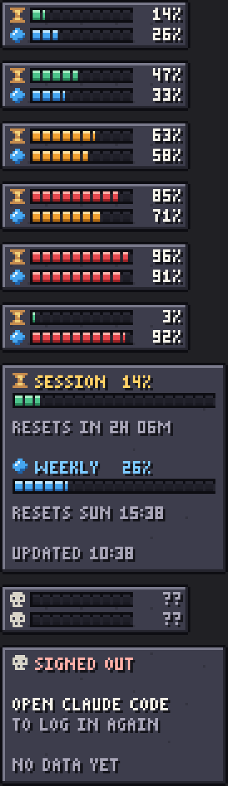

# Claude Usage HUD

A pixel-art game HUD that sits on your Windows taskbar and shows your Claude
plan limits:

- **Hourglass bar**: 5-hour session limit
- **Gem bar**: 7-day weekly limit

Bars go green or blue, then amber at 50%, then red at 80%. They blink at 90% and above.



## Run

Needs Python 3.10+ (standard library only, no pip installs).

```bash
pythonw claude_usage_hud.pyw
```

- **Hover** to see reset times
- **Click** to refresh
- By default it docks just left of the tray arrow and follows it as tray icons come and go
- **Drag** to move it anywhere (the position is saved)
- **Right-click** for Refresh, Start with Windows, Dock next to tray, and Quit

Try it without real data:

```bash
python claude_usage_hud.pyw --demo
```

Render a PNG preview:

```bash
python claude_usage_hud.pyw --snapshot preview.png --demo
```

## Where the data comes from

The widget reads the Claude Code sign-in token from `%USERPROFILE%\.claude\.credentials.json`
(or `CLAUDE_CONFIG_DIR`). It calls `https://api.anthropic.com/api/oauth/usage`
every 3 minutes. That is the same endpoint Claude Code's `/usage` uses, but
it's **unofficial** and may change.

The token is only ever sent to `api.anthropic.com`. The widget never refreshes or rewrites
your credentials. If it shows skulls and "SIGNED OUT", run `claude` in a
terminal once (or `/login`) so Claude Code refreshes its token, then click the widget.

Config (position) is stored in `%APPDATA%\ClaudeUsageHUD\config.json`.
"Start with Windows" adds an entry under `HKCU\...\CurrentVersion\Run`.
